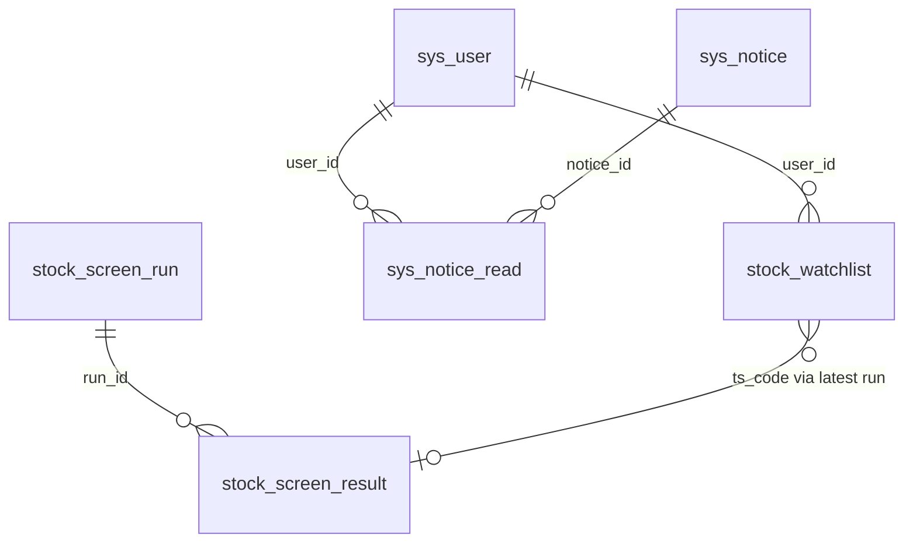

# Alchemy 数据存储：MySQL 与 Redis

> 类型：**本仓库约定**  
> 说明 Alchemy 相对官方若依在 **MySQL 表** 与 **Redis Key** 上的组成：哪些是框架自带的，哪些是本项目新建/扩展的。  
> 协作总则：`.cursor/rules/alchemy.mdc` + [`conventions.md`](conventions.md)。模块地图：[`conventions.md`](conventions.md)。

## 连接与脚本（占位符）

| 组件 | 配置位置 | 说明 |
| --- | --- | --- |
| MySQL | `ruoyi-admin/src/main/resources/application-druid.yml` | 示例：`jdbc:mysql://<host>:3306/<db>`，库名以环境为准（如 `appdb`） |
| Redis | `ruoyi-admin/src/main/resources/application.yml` → `spring.data.redis` | 默认 db `0`；密码用占位符 `<redis-password>` |
| 初始化 SQL | `sql/ry_20260417.sql`、`sql/stock_market_cache.sql` | 若依系统表 + Alchemy 扩展/业务表（含 Tushare 缓存） |
| 增量 SQL | `sql/patch_stock_watchlist.sql`、`sql/patch_stock_roe.sql`、`sql/patch_stock_dividend.sql`、`sql/patch_drop_code_gen.sql`、`sql/patch_guest_login.sql`、`sql/patch_sys_notice_menu.sql`、`sql/patch_stock_screen_job_cron.sql`、`sql/patch_member_menu_stock_list.sql`、`sql/patch_disable_captcha.sql`、`sql/patch_drop_system_tools.sql` | 已有生产库增量变更（用户自选、ROE、分红缓存、去掉代码生成菜单/空表、共享访客、通知公告菜单、筛股定时任务 cron、会员股票列表菜单、关闭图形验证码、去掉系统工具菜单） |
| Quartz SQL | `sql/quartz.sql` | Quartz 引擎内部表 `QRTZ_*`（见下文「未导入」） |

文档与 Agent 回复中 **勿写真实主机、账号、密码**；只使用上表占位符。

Key 常量统一定义在：`ruoyi-common/.../constant/CacheConstants.java`。

---

## MySQL：系统表 vs 新建/扩展

Alchemy 当前库（以 `ry_20260417.sql` 与 `sql/stock_market_cache.sql` 为准）共 **27 张业务相关表**（不含未导入的 `QRTZ_*`）。

### 分类总览

| 类别 | 表数量 | 持久化 | 筛股业务 |
| --- | --- | --- | --- |
| 若依标准系统表 | 16 | 是 | 不涉及 |
| **Alchemy 新建/扩展** | **11** | 是 | 筛股结果 2 张 + Tushare 缓存 7 张 + 公告已读 1 张 + 用户自选 1 张 |

### 若依标准系统表（16 张）

RuoYi 后台管理框架自带，**不是筛股业务数据**：

| 表名 | 用途 |
| --- | --- |
| `sys_dept` | 部门 |
| `sys_user` | 用户（含 `email` 字段；邮箱注册/找回密码 **不新增表**） |
| `sys_post` | 岗位 |
| `sys_role` | 角色 |
| `sys_menu` | 菜单 / 权限 |
| `sys_user_role` | 用户 ↔ 角色 |
| `sys_role_menu` | 角色 ↔ 菜单 |
| `sys_user_post` | 用户 ↔ 岗位 |
| `sys_config` | 系统参数（注册开关、验证码开关等） |
| `sys_dict_type` / `sys_dict_data` | 数据字典 |
| `sys_oper_log` | 操作日志 |
| `sys_logininfor` | 登录日志 |
| `sys_job` / `sys_job_log` | 定时任务及日志（含 Alchemy 自定义任务「股票筛选日更」） |
| `sys_notice` | 通知公告（管理端 CRUD + 用户收件箱数据源；菜单 **107**「通知公告」→ `/system/notice`，父菜单系统管理 `parent_id=1`，权限前缀 `system:notice:*`；增量见 `sql/patch_sys_notice_menu.sql`） |

代码生成用的 `gen_table` / `gen_table_column` **已移除**（模块 `ruoyi-generator` 已删）。存量库执行 `sql/patch_drop_code_gen.sql`。

### Alchemy 新建 / 扩展（11 张）

#### Tushare 原始数据缓存（新建，7 张）

定义见 `sql/stock_market_cache.sql`。`stock_basic` / `stock_trade_cal` / `stock_daily_basic` / `stock_daily_quote` / `stock_data_sync_log` 由 `python -m jobs.daily_run` 的 sync 阶段写入；**`stock_fina_indicator` 不是 sync 写入**，而是 screen 阶段由 `attach_candidate_roe` 按候选股按需拉取并 upsert。筛股策略读取这些缓存表。

| 表名 | 用途 | 唯一键 |
| --- | --- | --- |
| `stock_basic` | 上市股票主数据（对齐 Tushare `stock_basic`） | `ts_code` |
| `stock_trade_cal` | 交易日历（对齐 `trade_cal`） | `(exchange, cal_date)` |
| `stock_daily_basic` | 每日估值指标全字段（对齐 `daily_basic`） | `(ts_code, trade_date)` |
| `stock_daily_quote` | 日线行情全字段（对齐 `daily`） | `(ts_code, trade_date)` |
| `stock_fina_indicator` | 财务指标/ROE（对齐 `fina_indicator`；screen 时 `attach_candidate_roe` 写入） | `(ts_code, end_date)` |
| `stock_dividend` | 分红送股（对齐 `dividend`；建表 SQL 保留，screen **不再读写**） | `(ts_code, end_date, ann_date, div_proc)` |
| `stock_data_sync_log` | 同步水位（按 dataset + trade_date + status） | `(dataset, trade_date, status)` |

环境变量：`TUSHARE_TOKEN`（必填）、`STOCK_DB_*`（连同一 `appdb`）。

#### 筛股核心业务（新建，2 张）

定义见 `sql/ry_20260417.sql` 第 19、20 节；代码见 `ruoyi-system/.../domain/stock/`、`mapper/stock/`。

| 表名 | 用途 | 关系 |
| --- | --- | --- |
| `stock_screen_run` | 一次筛股运行快照（策略编码、交易日、命中数、状态等） | 1 |
| `stock_screen_result` | 单次运行的股票明细（PE、PB、ROE、MA120 信号等） | N，外键 `run_id` → `stock_screen_run` |

- 策略示例：`HIGH_DIVIDEND_MA120`
- 菜单：`股票列表`；权限前缀 `stock:screener:*`
- Controller：`ruoyi-admin/.../controller/stock/StockScreenResultController.java`
- 定时任务：`StockScreeningTask.refreshLatest` → ProcessBuilder 运行 `python -m jobs.daily_run`（sync + screen + 写结果表）。调度 `0 0/30 17-21 * * ?`（每天 17:00–21:30 每 30 分钟）；非交易日、当天已成功或估值未到则 CLI **exit 0** 不写失败 run。Quartz 用 **JVM 时区**，生产需 `Asia/Shanghai`。存量库执行 `sql/patch_stock_screen_job_cron.sql` 后须**重启 Java**（调度在内存，改 `sys_job` 不会热更新）。后台改 cron 时 `JOB_WHITELIST_STR` 须含 `com.ruoyi.web.task`，否则保存 invoke_target 会被拒。
- **原始行情缓存与筛股结果均落 MySQL，不走 Redis**
- 筛股结果股息率为 `stock_daily_basic.dv_ttm`（Tushare `daily_basic` 原值）。

#### 公告已读（扩展，1 张）

| 表名 | 用途 |
| --- | --- |
| `sys_notice_read` | 记录**登录用户**是否已读某条已发布公告（官方若依标准库一般无此表） |

代码：`SysNoticeRead.java`、`SysNoticeReadMapper.xml`。

**用户收件箱 API**（`SysNoticeInboxController`，与管理员 CRUD 同前缀 `/system/notice`）：

| 方法 | 路径 | 说明 |
| --- | --- | --- |
| GET | `/system/notice/inbox` | 最近 **50** 条已发布公告 + `isRead`（登录用户 JOIN `sys_notice_read`） |
| GET | `/system/notice/unread-count` | 未读数（登录用户）；访客返回已发布总数 |
| PUT | `/system/notice/read/{noticeId}` | 单条标已读（**访客 no-op**，不写表） |
| PUT | `/system/notice/read-all` | 全部标已读（**访客 no-op**，不写表） |

**访客已读不落库**：`SecurityUtils.isGuest()` 时 inbox 强制 `isRead=false`；标已读接口直接 `success()` 不写 `sys_notice_read`。前端用 `localStorage` 键 `alchemy.noticeRead.ids` 叠加已读态与角标（见 `ruoyi-ui/src/utils/noticeInbox.js`、`store/modules/notice.js`）。

#### 用户自选（新建，1 张）

定义见 `sql/ry_20260417.sql` 第 21 节与 `sql/patch_stock_watchlist.sql`。

| 表名 | 用途 | 唯一键 |
| --- | --- | --- |
| `stock_watchlist` | 登录用户自选股（只存代码 + 加入时名称/行业） | `(user_id, ts_code)` |

- 列表 LEFT JOIN 最新成功 `stock_screen_result`；不在快照中仍保留行，由应用标记「已不在候选池」
- Controller：`ruoyi-admin/.../controller/stock/StockWatchlistController.java` → `/stock/watchlist`
- **自选持久化在 MySQL，不走 Redis**

#### 共享访客账号（不新建表）

种子见 `sql/ry_20260417.sql` 与 `sql/patch_guest_login.sql`。登录名 `guest`，`user_type=01`，角色键 `guest`，筛股按钮权限与 `member_basic` 相同（`1061/1062/1063`）。密码哈希仅占位，禁止走 `/login`。

### 脚本有、线上库可能没有的表

`sql/quartz.sql` 定义 **11 张** Quartz 调度引擎内部表（`QRTZ_JOB_DETAILS`、`QRTZ_TRIGGERS` 等）。部分环境 **未导入** 这些表；若依仍通过 `sys_job` / `sys_job_log` 管理任务，不影响现有筛股日更任务。

### 邮箱注册 / 找回密码与数据库

以下能力 **不新增 MySQL 表**：

- 使用现有 `sys_user.email`
- 验证码与冷却存在 **Redis**（见下节）
- 邮件通过 Spring Mail 发送（`application.yml` → `spring.mail`）；SMTP `username` 用于认证，`spring.mail.from` 为收件箱可见的发件人别名

---

## Redis：系统 Key vs 新建 Key

Redis 在本项目中 **仅用于缓存与会话**，无「业务表」式设计；**筛股数据不在 Redis**。

### 分类总览

| 类别 | Key 前缀种类 | 持久性 | 筛股业务 |
| --- | --- | --- | --- |
| 若依系统 | 7 | 部分永久 + 部分 TTL | 不涉及 |
| **Alchemy 新建** | **4** | 全部 TTL | 不涉及 |

### 若依系统 Key（7 种）

定义于 `CacheConstants.java`；后台「系统监控 → 缓存监控」(`CacheController`) 展示其中 **7 类**（不含邮箱验证码，见下节说明）。

| 前缀 | 示例 | 用途 | TTL |
| --- | --- | --- | --- |
| `login_tokens:` | `login_tokens:{uuid}` | 登录会话 / Token 对应 `LoginUser` | 与 token 过期一致 |
| `captcha_codes:` | `captcha_codes:{uuid}` | 图形验证码 | 约 2 分钟 |
| `sys_config:` | `sys_config:sys.account.registerUser` | 系统参数缓存 | 永久（-1） |
| `sys_dict:` | `sys_dict:sys_user_sex` | 数据字典缓存 | 永久（-1） |
| `repeat_submit:` | `repeat_submit:{url}{tokenHeader}` | 防重复提交 | 注解配置（毫秒） |
| `rate_limit:` | `rate_limit:{IP}-类名-方法名` | 接口限流（含 `POST /login/guest`：30 次 / 3600 秒 / IP） | 注解配置（秒） |
| `pwd_err_cnt:` | `pwd_err_cnt:{username}` | 密码错误锁定计数 | 分钟级 |

典型代码位置：

- Token：`TokenService`
- 图形验证码：`CaptchaController`、`SysLoginService`、`SysRegisterService`
- 参数 / 字典：`SysConfigServiceImpl`、`DictUtils`
- 防重 / 限流：`SameUrlDataInterceptor`、`RateLimiterAspect`
- 密码错误：`SysPasswordService`

**空闲环境下** Redis 里可能只剩 `sys_config:*` 与 `sys_dict:*`（应用启动预热）；登录 Token、验证码等临时 Key 随 TTL 过期或服务停止而消失。

### Alchemy 新建 Key（4 种）

邮箱注册与找回密码专用；**未** 列入 `CacheController` 监控列表，但实际写入同一 Redis 实例。

| 前缀 | 示例 | 用途 | TTL |
| --- | --- | --- | --- |
| `email_code:` | `email_code:{email}` | 注册邮箱验证码 | 10 分钟 |
| `email_code_limit:` | `email_code_limit:{email}` | 注册发码冷却 | 60 秒 |
| `reset_pwd_email_code:` | `reset_pwd_email_code:{email}` | 找回密码验证码 | 10 分钟 |
| `reset_pwd_email_code_limit:` | `reset_pwd_email_code_limit:{email}` | 找回密码发码冷却 | 60 秒 |

代码：

- 注册：`SysRegisterService`
- 找回密码：`SysForgetPasswordService`

匿名接口（`SecurityConfig` 白名单）：`/login/guest`、`/register/emailCode`、`/resetPwd/emailCode`、`/resetPwd/byEmail`。

### 筛股业务与 Redis

**无任何** `stock_*` / screener 相关 Redis Key。筛股结果由 CLI 写入 MySQL `stock_screen_run` / `stock_screen_result`。

---

## 对照关系（一图）

```text
MySQL (<db>)
├── sys_*                      ← 若依框架
├── stock_screen_run           ← Alchemy 筛股（持久化）
├── stock_screen_result        ← Alchemy 筛股（持久化）
├── stock_fina_indicator       ← Alchemy Tushare 财务指标缓存（持久化）
├── stock_dividend             ← Alchemy Tushare 分红送股缓存（持久化；闲置，screen 不再读写）
├── stock_watchlist            ← Alchemy 用户自选（持久化）
└── sys_notice_read            ← Alchemy 扩展

Redis (db 0)
├── login_tokens / captcha_codes / sys_config / sys_dict / …  ← 若依
└── email_code* / reset_pwd_email_code*                       ← Alchemy 邮箱验证码（临时）
    （筛股不在 Redis）
```



---

## Agent / 排查清单

| 场景 | 查哪里 |
| --- | --- |
| 筛股结果为空 | MySQL `stock_screen_run` / `stock_screen_result`；定时任务 `sys_job`；CLI/`STOCK_DB_*` 配置 |
| 注册/登录验证码 | Redis `captcha_codes:*`；`sys_config:sys.account.captchaEnabled` |
| 邮箱验证码失败 | Redis `email_code:*` 或 `reset_pwd_email_code:*` 及对应 `*_limit:*` |
| 登录态 / 401 | Redis `login_tokens:*` |
| 字典/参数不生效 | Redis `sys_dict:*` / `sys_config:*`，或回源 `sys_dict_*` / `sys_config` 表 |
| 新增业务是否要 Redis | 筛股类持久数据 → MySQL；短期验证码/会话 → Redis |

---

## 维护说明

- 表结构变更：同步更新 `sql/ry_20260417.sql` 与本文件。
- 新增 Redis Key 前缀：更新 `CacheConstants.java` 与本文件；若需运维可见，考虑加入 `CacheController` 监控列表。
- 行数、Key 数量为 **环境快照**，会随使用变化；以 `SHOW TABLES` / `KEYS`（或 Redis SCAN）为准。
